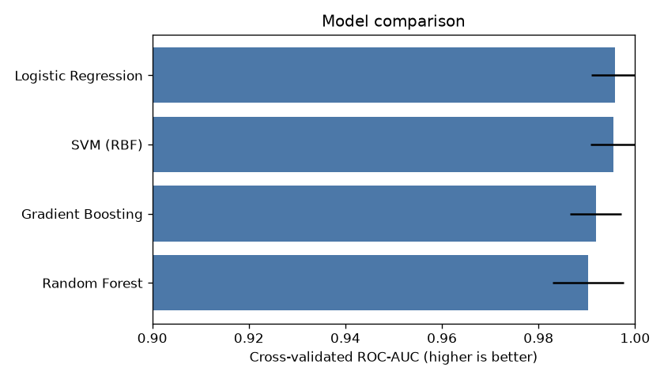
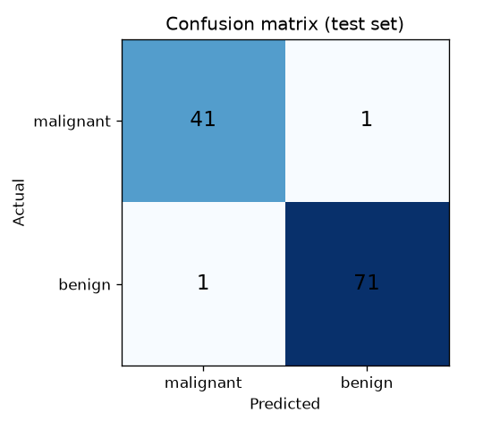
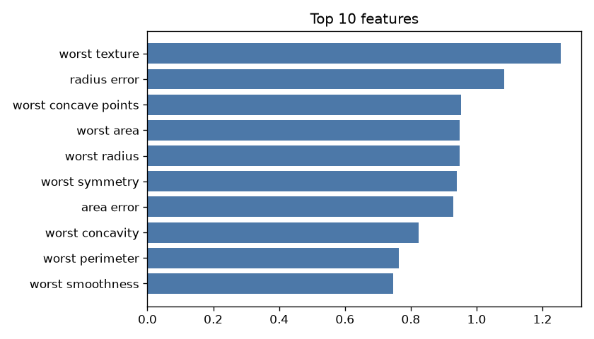

# 🩺 Breast Cancer Risk Predictor

An end-to-end machine-learning project. It compares four classifiers on the Wisconsin Breast Cancer dataset, picks the best one with cross-validation, measures it on a held-out test set, and serves it in an interactive Streamlit web app.

> Educational project. **Not medical advice.**

## Results

| Model | 5-fold CV ROC-AUC |
|---|---|
| **Logistic Regression** (selected) | **0.996** |
| SVM (RBF) | 0.996 |
| Gradient Boosting | 0.992 |
| Random Forest | 0.990 |

Hold-out test set (20%, 114 patients): **accuracy 98.2%, ROC-AUC 0.995, malignant recall 97.6%**

| Model comparison | Confusion matrix | Top features |
|---|---|---|
|  |  |  |

## What it shows

- **Data:** scikit-learn's built-in dataset (569 tumours, 30 numeric features). Nothing to download.
- **Fair comparison:** every model runs inside a `StandardScaler → classifier` pipeline, so scaling is learned only from training folds (no data leakage).
- **Model selection:** stratified 5-fold cross-validation on the training split only.
- **Evaluation:** precision, recall and F1 for the *malignant* class (the one we must not miss), plus ROC-AUC and a confusion matrix.
- **Deployment:** a Streamlit app with 30 inputs, a "random test patient" button and a model-performance tab. It can be deployed free on Streamlit Community Cloud, and a Dockerfile is included.
- **Tests:** unit tests for the ML pipeline plus a headless test of the web app.

## Project structure

```
DS_Breast_Cancer_Predictor/
├── model.py            # load data, compare models, train, evaluate, save/load, predict
├── train.py            # CLI: trains + writes models/model.joblib and reports/*.png
├── app.py              # Streamlit web app
├── tests/
│   ├── test_model.py   # ML pipeline tests (accuracy thresholds, predict, save/load)
│   └── test_app.py     # Streamlit app smoke tests (no browser needed)
├── reports/            # charts + metrics.json (generated by train.py)
├── models/             # trained model (generated, not committed)
├── requirements.txt
└── Dockerfile          # to run anywhere with Docker
```

## How to run (step by step)

You need **Python 3.10 or newer**. Check with `python --version` (on Windows you may need `py --version`).

### 1. Get the code

```bash
git clone https://github.com/<your-username>/DS_Breast_Cancer_Predictor.git
cd DS_Breast_Cancer_Predictor
```

### 2. Create a virtual environment and install packages

**Windows (PowerShell):**
```powershell
python -m venv .venv
.venv\Scripts\Activate.ps1
pip install -r requirements.txt
```
If PowerShell blocks the activate script, run `Set-ExecutionPolicy -Scope CurrentUser RemoteSigned` once, then try again.

**macOS / Linux:**
```bash
python3 -m venv .venv
source .venv/bin/activate
pip install -r requirements.txt
```

### 3. Run the tests

```bash
python -m pytest -v
```
Expected: `9 passed` (takes about 10 seconds).

### 4. Train the model

```bash
python train.py
```
This prints the model comparison and test metrics, and writes `models/model.joblib` and the charts in `reports/`.

### 5. Start the web app

```bash
streamlit run app.py
```
Open http://localhost:8501. Click **🎲 Random test patient** to load a real patient from the test set and see the prediction next to the actual diagnosis.

(If you skip step 4, the app trains the model itself on first start, in about 20 seconds.)

## Deploy free on Streamlit Community Cloud

1. Sign in at https://share.streamlit.io with your GitHub account.
2. Click **Create app → Deploy a public app from GitHub**.
3. Fill in **Repository** `<your-username>/DS_Breast_Cancer_Predictor`, **Branch** `main` and **Main file path** `app.py`.
4. Click **Deploy**.

After a few minutes the app is live at a public `https://<name>.streamlit.app` link. Apps with no visitors for 12 hours go to sleep; the next visitor wakes them with one click.

## Run with Docker (optional)

```bash
docker build -t breast-cancer-app .
docker run -p 8501:8501 breast-cancer-app
```

## Tech stack

Python · pandas · scikit-learn · matplotlib · Streamlit · pytest · Docker
